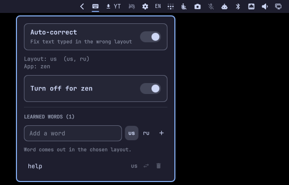
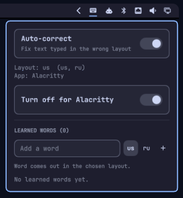

# relayout



Automatic keyboard-layout correction for Wayland/Hyprland (Omarchy), in the
spirit of Punto Switcher.

Type without thinking about the layout. When a word comes out in the wrong
one (`cgfcb,j` → `спасибо`, `цудсщьую` → `welcome.`), relayout retypes it in the
right layout when you press Space or punctuation **and switches the layout
for you**, so you keep typing. Everything runs locally; nothing typed is sent anywhere or
written to disk.

## Features

- **Auto-correct on Space or punctuation.** A word-frequency list plus a
  letter-trigram model scores the word in both layouts and flips it when the
  other layout is clearly more likely. On random Wikipedia text (words typed
  once right and once on the wrong layout) it flips about 96% of mistyped
  words and wrongly flips 0.3-0.4% of correct ones, mostly single letters and
  rare names; reproduce with `scripts/eval.py`. Punctuation typed right after
  a word (`Gjujlf?` → `Погода,`, `цудсщьую` → `welcome.`) triggers it too; keys
  that are letters on the other layout (`.` is `ю`) need extra evidence so the
  first half of a correct word is never flipped.
- **Double-tap Left Shift** (configurable) to flip by hand: selected text,
  or the last word, even after you've pressed Space. A selection is only
  used right after you made one (mouse drag, double/triple click,
  Shift+arrows, Ctrl+A), never an old one the compositor still remembers.
  After a correction the same hotkey **toggles** the word back and forth until you type, click or switch windows (60 s at most).
- **Learns your words.** Flip the same word by hand twice, or undo the same
  auto-correction twice, and relayout remembers: `next` typed on the
  Russian layout (`туче`, a real Russian word) now always flips.
- **Careful by design.** It leaves alone words with digits, symbols inside
  the word (URLs, emails, flags; a trailing `?` or a hyphen between letters
  is fine), `camelCase`/`iPhone`/ALL CAPS, executables in `$PATH` (`jq`,
  `gcc`), text typed with Ctrl/Alt/Super held, and anything after a click or
  arrow key. Password managers, the polkit prompt and the lock screen are
  excluded by default, and because it only acts when you press Space or
  punctuation, passwords are rarely affected.
- **Works in every app.** A correction replays the same physical keys on a
  virtual keyboard after switching the layout (tested in a terminal and
  Chromium); if `/dev/uinput` isn't writable it falls back to `wtype`.
- **Bar widget** for Omarchy: on/off state, per-app exclusion, and adding,
  moving or removing learned words (see [Bar widget](#bar-widget)).

## How it works

relayout reads key events passively from `/dev/input` (it never grabs the
keyboard, so typing is never delayed) and compiles the real XKB keymap of
each layout in the pair with `libxkbcommon`, so it knows exactly which
character each physical key produces in either layout. When you press Space
or a word-ending punctuation key it renders the last word in both layouts,
scores each, and, if the other one wins by a margin, sends Backspace,
switches the layout with `hyprctl switchxkblayout` and replays the keys. A
correction is dropped if you type another key before it runs.

Layout pairs need a word list in `relayout/data/<lang>.txt.gz`. `us`/`gb`
(en) and `ru` ship by default; other pairs still get the hotkey, and you can
add a language with `scripts/build-wordlists.py` (see `relayout/data/README.md`).

## Privacy and permissions

relayout has to see what you type, so:

- Only the current line's recent keys are kept, in memory, and cleared on
  Enter, Tab, clicks, arrow keys, shortcuts, while the screen is locked and
  after 10 s idle. Nothing is logged or sent anywhere.
- `~/.local/share/relayout/state.json` stores only your settings, excluded
  apps and words you taught it by hand. It is plain JSON.
- The `relayout` command and the widget talk to the daemon over a Unix socket
  at `$XDG_RUNTIME_DIR/relayout.sock` (mode 0600, your user only).
- Reading keyboards needs membership in the `input` group. Any program
  running as you with that permission can read your keystrokes: that is the
  cost of a global layout corrector on Wayland.

## Requirements

- Linux, Wayland, Hyprland (`hyprctl`); Omarchy is only needed for the widget
- Python 3.11+ with the `venv` module (Debian/Ubuntu: `python3-venv`),
  `rsync`, systemd (`systemctl --user`), a C compiler and the `libxkbcommon`
  headers (the Python packages `xkbcommon` and `evdev` are built from source
  into a private virtualenv)
- `wl-clipboard` and `wtype` (installed on Omarchy by default); `notify-send`
  is optional, for the "learned a word" notification
- Write access to `/dev/uinput` for key replay (otherwise `wtype` is used)
- Membership in the `input` group (the install script sets this up)

## Install

```bash
git clone https://github.com/airenare/relayout.git
cd relayout
./scripts/install.sh
```

If you weren't in the `input` group, the script adds you and asks you to log
out and in, then re-run it. Re-run it after `git pull` to update.

The installer is deliberately conservative:

- Dependencies are installed from `requirements.lock` with exact versions and
  hash checking (`pip --require-hashes --no-deps`) into a fresh virtualenv, so
  one commit always installs the same code. Nothing else is resolved from the
  network.
- It only replaces files relayout created. If `~/.config/systemd/user/relayout.service`,
  `~/.local/bin/relayout` or `~/.local/share/relayout` already exists and
  belongs to something else, it stops and says so; `--force` overrides.
- It checks for `python3`, `venv`, `rsync` and `systemctl` up front.

If `/dev/uinput` isn't writable the script says so and relayout retypes with
`wtype` instead.

## Bar widget

```bash
omarchy plugin add https://github.com/airenare/relayout --enable
```



A keyboard icon, dimmed while auto-correction is off or paused (excluded
app, polkit prompt, lock screen). Left click opens a panel: auto-correct
on/off, turn it off for the current app, add a word to a layout, move a
learned word to the other layout, or remove it. Right click toggles
auto-correction. The widget only talks to the daemon through the `relayout`
command (installed to `~/.local/bin`), so the daemon must be installed.

## Commands

```
relayout status                      # JSON state
relayout auto on|off|toggle
relayout exclude add|rm CLASS        # window class, see `hyprctl activewindow`
relayout exclude list
relayout rules list | add WORD [LAYOUT] | rm WORD
relayout flip                        # same as the hotkey
relayout subscribe                   # stream JSON state on every change
```

`rules add next` makes `next` always come out as `next` (typing `туче`
turns into it); `rules add привет` does the opposite for a Russian word.

## Configuration

Edit `~/.config/relayout/config.toml`, then `systemctl --user restart relayout`:

```toml
[layouts]
pair = ["us", "ru"]       # any two XKB layout codes configured in Hyprland

[hotkey]
key = "KEY_LEFTSHIFT"     # any evdev key name
taps = 2                  # number of taps to trigger
window_ms = 400           # max milliseconds between taps

[buffer]
max_len = 500             # max buffered keystrokes
idle_timeout_s = 10       # buffer clears after this many seconds idle

[output]
method = "auto"           # "uinput" (replay keys), "wtype", or auto

[auto]
enabled = true            # correct on Space/punctuation (also toggled by the widget)
threshold = 4.0           # higher = more cautious; 2-6 is the useful range
learn_threshold = 2       # manual flips/undos before a word is remembered
notify = true             # desktop notification when a word is learned
exclude_apps = ["org.keepassxc.KeePassXC", "1Password", "Bitwarden",
                "gcr-prompter", "pinentry-qt", "pinentry-gtk"]
exclude_layers = ["omarchy-polkit"]   # shell popups (layer-shell namespaces)
```

`enabled` and `exclude_apps` are only the starting values. Once `state.json`
exists (the widget, `relayout` or a learned word wrote it), it wins; change
them with the widget/`relayout` commands or edit `state.json` by hand.

## Uninstall

```bash
omarchy plugin remove air.relayout          # the widget, if installed
systemctl --user disable --now relayout
rm -f ~/.config/systemd/user/relayout.service ~/.local/bin/relayout
rm -rf ~/.local/share/relayout              # program and learned words
```

Settings in `~/.config/relayout` are kept; delete them by hand. Leave the
`input` group with `sudo gpasswd -d "$USER" input` if nothing else needs it.

## Development

```bash
python3 -m venv .venv
./.venv/bin/pip install -e ".[dev]"
./.venv/bin/pytest
```

`scripts/eval.py en|ru FILE` scores the detector on any text file;
`scripts/build-wordlists.py` rebuilds the word lists.

The evdev glue (`relayout/input_listener.py`) needs real input devices, so
it is verified end to end by injecting keys through a virtual `uinput`
keyboard into a terminal and a browser window with the daemon running.
Release checklist: tests green, `omarchy plugin validate` on a clean copy
of the repo (without `.venv`).

## Credits and license

Auto-detection (word list + letter-trigram scoring) is modelled on
[layoutless](https://github.com/kladaFOX/layoutless) by kladaFOX, which is
worth a look for a Rust implementation of the same idea.

MIT for the code. The bundled word lists in `relayout/data/` derive from
[hermitdave/FrequencyWords](https://github.com/hermitdave/FrequencyWords) and
are licensed under [CC BY-SA 4.0](https://creativecommons.org/licenses/by-sa/4.0/).
